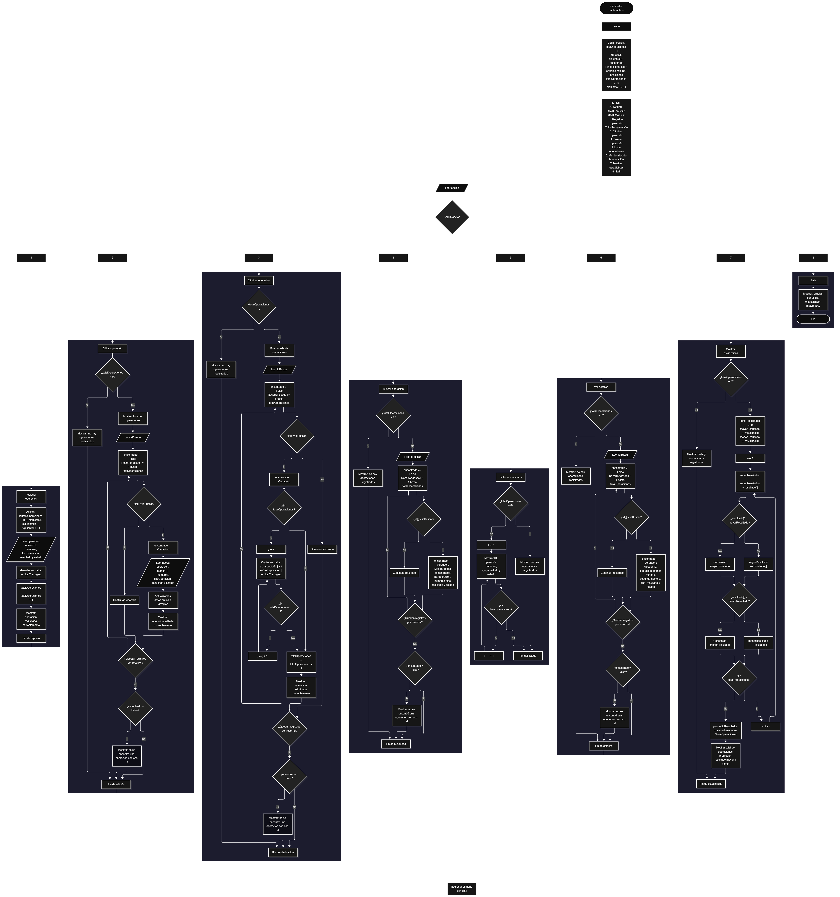

Este proyecto, llamado <b>analizador matemático</b>, fue desarrollado en <b>pseint</b> como un ejercicio práctico para fortalecer la lógica de programación mediante la creación de un sistema de gestión de operaciones matemáticas desde la consola. El programa cuenta con un menú principal de <b>ocho opciones</b> que permite <b>registrar, editar, eliminar, buscar, listar y consultar los detalles</b> de las operaciones registradas, además de mostrar estadísticas generales y finalizar la ejecución. Cada operación almacena datos como el identificador, la descripción de la operación, el primer número, el segundo número, el tipo de operación, el resultado y el estado, utilizando arreglos con una capacidad definida de <b>100 posiciones durante la ejecución</b>. Durante su desarrollo se aplicaron conceptos fundamentales de programación, como variables, arreglos, estructuras condicionales, ciclos repetitivos y estructuras de selección, además de procesos para buscar, modificar, eliminar y organizar registros. Este proyecto permite poner en práctica los conocimientos adquiridos en PSeInt y sirve como base para desarrollar sistemas de gestión matemática más avanzados utilizando otros lenguajes y tecnologías.

<h2 align="center">⚙️ Funcionamiento del menú principal</h2>

### ➕ Registrar operación

La opción <b>1) registrar operación</b> permite registrar una nueva operación matemática. Primero, el programa asigna un identificador utilizando el arreglo <b>id</b> y la variable <b>siguienteID</b>, que aumenta en uno después de asignar el identificador. A continuación, solicita la descripción de la operación, el primer número, el segundo número, el tipo de operación, el resultado y el estado. Estos datos se almacenan en la posición correspondiente de los arreglos <b>id, operacion, numero1, numero2, tipoOperacion, resultado y estado</b>. Después de introducir todos los datos, la variable <b>totalOperaciones</b> aumenta en uno y el programa muestra el mensaje <b>"operacion registrada correctamente."</b>. Aunque los arreglos tienen una capacidad de 100 posiciones, el código actual no comprueba si se ha alcanzado ese límite antes de registrar una nueva operación. Además, el resultado se introduce manualmente y no se calcula automáticamente a partir de los números y el tipo de operación seleccionados.

### ✏️ Editar operación

La opción <b>2) editar operación</b> permite modificar los datos de una operación registrada. Primero, el programa comprueba si existen operaciones almacenadas mediante la variable <b>totalOperaciones</b>. Si no hay registros, muestra el mensaje <b>"no hay operaciones registradas."</b>. En caso contrario, presenta una lista con el identificador, la descripción, los dos números, el tipo de operación, el resultado y el estado de cada registro. Después, solicita el identificador de la operación que se desea editar e inicializa la variable lógica <b>encontrado</b> con el valor <b>falso</b>. Mediante un ciclo <b>para</b>, recorre los registros y compara los identificadores. Cuando encuentra una coincidencia, cambia <b>encontrado</b> a <b>verdadero</b> y solicita la nueva información de la operación, actualizando los valores de los arreglos correspondientes. Finalmente, muestra el mensaje <b>"operacion editada correctamente."</b>. Si el identificador no corresponde a ninguna operación registrada, presenta el mensaje <b>"no se encontró una operacion con ese id."</b>. El ciclo continúa su recorrido después de encontrar una coincidencia.

### 🗑️ Eliminar operación

La opción <b>3) eliminar operación</b> permite eliminar una operación registrada mediante su identificador. Antes de comenzar, el programa comprueba si existen operaciones almacenadas. Si la variable <b>totalOperaciones</b> es igual a cero, muestra el mensaje <b>"no hay operaciones registradas."</b>. Si existen registros, presenta una lista con los datos de las operaciones y solicita el identificador que se desea eliminar. Después, inicializa la variable <b>encontrado</b> en <b>falso</b> y recorre los registros mediante un ciclo <b>para</b>. Cuando encuentra el identificador solicitado, cambia la variable a <b>verdadero</b> y comprueba si la posición es anterior a la última operación registrada. Si se cumple esta condición, utiliza un ciclo <b>para</b> controlado por la variable <b>j</b> para desplazar una posición hacia atrás los datos de los arreglos <b>id, operacion, numero1, numero2, tipoOperacion, resultado y estado</b>. Posteriormente, disminuye <b>totalOperaciones</b> en uno y muestra el mensaje <b>"operacion eliminada correctamente."</b>. Si no encuentra el identificador, presenta el mensaje <b>"no se encontró una operacion con ese id."</b>. El código no limpia explícitamente la última posición después de eliminar un registro y modifica el contador dentro del ciclo de búsqueda, lo que puede afectar el recorrido de la eliminación.

### 🔎 Buscar operación

La opción <b>4) buscar operación</b> permite localizar una operación mediante su identificador. Primero, el programa comprueba si existen registros almacenados. Si no hay operaciones, muestra el mensaje <b>"no hay operaciones registradas."</b>. En caso contrario, solicita el identificador que se desea buscar e inicializa la variable lógica <b>encontrado</b> con el valor <b>falso</b>. A continuación, utiliza un ciclo <b>para</b> para recorrer los identificadores almacenados y compararlos con el valor introducido mediante la condición <b>id[i] = idBuscar</b>. Cuando encuentra una coincidencia, cambia la variable <b>encontrado</b> a <b>verdadero</b>, muestra el mensaje <b>"datos encontrados"</b> y presenta el identificador, la descripción de la operación, el primer número, el segundo número, el tipo de operación, el resultado y el estado. Si finaliza el recorrido sin encontrar coincidencias, muestra el mensaje <b>"no se encontró una operacion con ese id."</b>. La búsqueda no interrumpe el ciclo después de encontrar un registro, sino que continúa recorriendo las posiciones restantes.

### 📋 Listar operaciones

La opción <b>5) listar operaciones</b> permite visualizar todas las operaciones registradas. Antes de mostrar la información, el programa comprueba si la variable <b>totalOperaciones</b> es igual a cero. Si no existen registros, presenta el mensaje <b>"no hay operaciones registradas."</b>. Si hay operaciones disponibles, muestra el encabezado <b>"datos registrados"</b> y utiliza un ciclo <b>para</b> para recorrer los arreglos desde la primera posición hasta el total de operaciones registradas. Durante el recorrido, presenta en una misma línea el identificador, la descripción de la operación, el primer número, el segundo número, el tipo de operación, el resultado y el estado. Esta función facilita consultar todos los registros almacenados sin necesidad de buscar cada operación individualmente.

### 📄 Ver detalles de la operación

La opción <b>6) ver detalles de la operación</b> permite consultar toda la información de una operación específica. Primero, el programa comprueba si existen operaciones registradas. Si no hay registros, muestra el mensaje <b>"no hay operaciones registradas."</b>. En caso contrario, solicita el identificador de la operación que se desea consultar e inicializa la variable lógica <b>encontrado</b> con el valor <b>falso</b>. Después, utiliza un ciclo <b>para</b> para recorrer los identificadores y localizar una coincidencia. Cuando encuentra la operación, cambia la variable a <b>verdadero</b> y muestra los detalles en líneas separadas: identificador, descripción de la operación, primer número, segundo número, tipo de operación, resultado y estado. Si el identificador no corresponde a ninguna operación registrada, presenta el mensaje <b>"no se encontró una operacion con ese id."</b>.

### 📊 Mostrar estadísticas

La opción <b>7) mostrar estadísticas</b> permite obtener información general sobre los resultados de las operaciones registradas. Primero, el programa comprueba si existen registros. Si no hay operaciones almacenadas, muestra el mensaje <b>"no hay operaciones registradas."</b>. Si existen operaciones, inicializa la variable <b>sumaResultados</b> en cero y establece el primer elemento del arreglo <b>resultado</b> como valor inicial de <b>mayorResultado</b> y <b>menorResultado</b>. Después, utiliza un ciclo <b>para</b> para recorrer todos los resultados, acumular sus valores en <b>sumaResultados</b> y comparar cada uno con los valores mayor y menor actuales. Cuando encuentra un resultado superior al máximo, actualiza <b>mayorResultado</b>; cuando encuentra uno inferior al mínimo, actualiza <b>menorResultado</b>. Al finalizar el recorrido, calcula el promedio mediante la expresión <b>sumaResultados / totalOperaciones</b> y almacena el valor en <b>promedioResultados</b>. Finalmente, muestra el total de operaciones, el promedio de resultados, el resultado mayor y el resultado menor. Estas estadísticas se calculan a partir de los resultados introducidos por el usuario, sin comprobar si son matemáticamente correctos.

### 🚪 Salir del menú principal

La opción <b>8) salir</b> permite finalizar la ejecución del programa y muestra el mensaje <b>"gracias por utilizar el analizador matematico."</b>. El menú principal se encuentra dentro de una estructura repetitiva <b>repetir ... hasta que</b>, que mantiene el programa en funcionamiento mientras el usuario selecciona las diferentes opciones disponibles. En este caso, la condición final es <b>hasta que opcion = 8</b>, por lo que al seleccionar la opción 8 el ciclo termina y el algoritmo finaliza. Si el usuario introduce una opción que no está definida en el menú, el bloque <b>de otro modo</b> muestra el mensaje <b>"opción no válida."</b>.

<h2 align="center">🧠 Temas aplicados en el proyecto</h2>

### 📦 Variables

En este proyecto se utilizan variables para almacenar la opción seleccionada en el menú, controlar la cantidad de operaciones registradas, generar identificadores, recorrer los arreglos, localizar registros, modificar información y calcular estadísticas. Cada variable cumple una función específica dentro de las operaciones de gestión matemática. También se utilizan variables auxiliares para acumular resultados, identificar los valores mayores y menores y calcular el promedio general.

🔢 **Opcion:** Almacena la opción seleccionada por el usuario en el menú principal.

📊 **TotalOperaciones:** Almacena la cantidad actual de operaciones registradas.

🔄 **I:** Funciona como contador en los ciclos <b>para</b> y permite recorrer las posiciones de los arreglos.

🔁 **J:** Controla el recorrido utilizado para desplazar los datos durante la eliminación de una operación.

🆔 **SiguienteID:** Genera identificadores consecutivos para las operaciones registradas.

🔎 **IDBuscar:** Almacena el identificador introducido por el usuario para buscar, editar, eliminar o consultar una operación.

✅ **Encontrado:** Variable lógica que indica si se encontró una operación con el identificador solicitado.

➕ **SumaResultados:** Acumula los resultados almacenados para calcular el promedio.

📈 **MayorResultado:** Guarda el resultado de mayor valor encontrado durante el recorrido.

📉 **MenorResultado:** Guarda el resultado de menor valor encontrado durante el recorrido.

📊 **PromedioResultados:** Almacena el promedio de los resultados registrados.

### 🗃️ Arreglos

En este proyecto se utilizan siete arreglos relacionados con los datos de cada operación matemática. Cada arreglo tiene una capacidad definida de <b>100 posiciones</b> y utiliza el mismo índice para representar la información correspondiente a un mismo registro. Por ejemplo, los datos de una operación almacenada en la posición <b>1</b> se encuentran distribuidos entre <b>id[1], operacion[1], numero1[1], numero2[1], tipoOperacion[1], resultado[1] y estado[1]</b>. Esta organización permite recorrer, buscar, modificar, mostrar y eliminar operaciones de manera ordenada.

🆔 **ID[100]:** Almacena los identificadores de las operaciones registradas.

📝 **Operacion[100]:** Almacena la descripción de cada operación matemática.

🔢 **Numero1[100]:** Almacena el primer número de cada operación.

🔢 **Numero2[100]:** Almacena el segundo número de cada operación.

🧮 **TipoOperacion[100]:** Almacena el tipo de operación indicado por el usuario.

📊 **Resultado[100]:** Almacena los resultados introducidos manualmente.

📌 **Estado[100]:** Almacena el estado indicado para cada operación.

### 🔀 Estructuras condicionales

En este proyecto se utilizan las estructuras <b>si</b> y <b>siNo</b> para comprobar si existen operaciones registradas antes de realizar determinadas funciones, identificar si un registro coincide con el identificador solicitado, determinar si una operación ocupa una posición anterior a la última durante la eliminación y comparar los resultados para calcular las estadísticas. También se utiliza la variable lógica <b>encontrado</b> para comprobar si una búsqueda localizó una operación. Estas condiciones permiten ejecutar diferentes instrucciones según los datos almacenados y el resultado de cada comparación.

### 🔄 Estructuras repetitivas

En este proyecto se utilizan los ciclos <b>para</b> y <b>repetir ... hasta que</b>. Los ciclos <b>para</b> permiten recorrer los arreglos para mostrar las operaciones, buscar identificadores, editar registros, consultar detalles y calcular estadísticas. Durante la eliminación, también se utilizan para desplazar los datos de las operaciones posteriores una posición hacia atrás. Por otro lado, el ciclo <b>repetir ... hasta que</b> mantiene activo el menú principal para que el usuario pueda ejecutar diferentes operaciones hasta seleccionar la opción <b>8</b>, que finaliza el programa.

### 🎯 Estructura según

El programa evalúa el valor almacenado en la variable <b>opcion</b> mediante la estructura <b>segun opcion hacer</b> y ejecuta el bloque de instrucciones correspondiente. Cada caso representa una funcionalidad específica del sistema: <b>registrar, editar, eliminar, buscar, listar, ver detalles, mostrar estadísticas o salir</b>. También se utiliza el bloque <b>de otro modo</b> para mostrar el mensaje <b>"opción no válida."</b> cuando el valor introducido no coincide con ninguna de las opciones definidas. Esta estructura organiza el menú principal y facilita la selección de las diferentes operaciones disponibles.

### 🔢 Dimensionamiento de arreglos

El programa utiliza la instrucción <b>dimension</b> para establecer una capacidad de <b>100 posiciones</b> en cada uno de los siete arreglos. Esta organización permite almacenar los datos relacionados con las operaciones matemáticas utilizando posiciones equivalentes. La cantidad de registros activos se controla mediante la variable <b>totalOperaciones</b>, que aumenta cuando se registra una operación y disminuye cuando se elimina. Sin embargo, el código no comprueba si se ha alcanzado la capacidad máxima antes de realizar un nuevo registro.

### 🔄 Reorganización de registros

Cuando se selecciona una operación para eliminarla, el programa utiliza un ciclo <b>para</b> controlado por la variable <b>j</b>, que comienza en la posición del registro encontrado y llega hasta <b>totalOperaciones - 1</b>. En cada repetición, los datos de la posición siguiente se copian sobre la posición actual en los siete arreglos: <b>id, operacion, numero1, numero2, tipoOperacion, resultado y estado</b>. Después, la variable <b>totalOperaciones</b> disminuye en uno. De esta manera, los registros posteriores ocupan las posiciones anteriores. El código no limpia explícitamente la última posición y modifica el contador dentro del ciclo de búsqueda, por lo que el comportamiento del recorrido debe tenerse en cuenta al analizar esta operación.

<h2 align="center">¿Cómo se implementaron las operaciones crud en el proyecto?</h2>

Las operaciones <b>crud</b> se implementaron mediante las opciones del menú principal, permitiendo administrar las operaciones matemáticas registradas. La operación <b>crear</b> corresponde a <b>registrar operación</b>, donde se asigna un identificador y se almacenan los datos de una nueva operación. La operación <b>leer</b> se realiza mediante las opciones <b>buscar operación, listar operaciones y ver detalles de la operación</b>, que permiten localizar y consultar los registros existentes. La operación <b>actualizar</b> corresponde a <b>editar operación</b>, donde se modifican los datos de una operación registrada. Finalmente, la operación <b>eliminar</b> se realiza mediante <b>eliminar operación</b>, donde se desplazan los registros posteriores y se reduce el contador de operaciones. Estas funciones utilizan variables, arreglos, condicionales y ciclos para gestionar la información almacenada temporalmente durante la ejecución del programa.

<h2 align="center">Diagrama de flujo del proyecto</h2>

<h2 align="center">🛡️ Validaciones del programa</h2>

### 📭 No existen operaciones registradas

Esta comprobación se utiliza en las opciones de <b>editar, eliminar, buscar, listar, ver detalles y mostrar estadísticas</b>. El programa comprueba si la variable <b>totalOperaciones</b> es igual a <b>0</b>. Si no existen operaciones registradas, muestra el mensaje <b>"no hay operaciones registradas."</b>. Esta comprobación evita continuar con las funciones que necesitan información almacenada cuando el contador indica que no hay registros disponibles.

### ❌ Operación no encontrada

Esta comprobación se utiliza durante las operaciones de <b>editar, eliminar, buscar y ver detalles</b>. El programa inicializa la variable lógica <b>encontrado</b> con el valor <b>falso</b> y recorre el arreglo <b>id</b> para comparar los identificadores almacenados con el valor introducido por el usuario. Si encuentra una coincidencia, cambia la variable a <b>verdadero</b> y ejecuta las instrucciones correspondientes. Si termina el recorrido y la variable continúa siendo <b>falso</b>, muestra el mensaje <b>"no se encontró una operacion con ese id."</b>. Esta comprobación permite informar cuando no existe una operación con el identificador solicitado.

### ⚠️ Opción inválida

Esta comprobación se encuentra en el bloque <b>de otro modo</b> de la estructura <b>segun opcion hacer</b>. Cuando el usuario introduce un valor que no coincide con ninguna de las opciones definidas, el programa muestra el mensaje <b>"opción no válida."</b>. Esta condición permite informar que la selección no corresponde a una función disponible en el menú principal.

### 🔢 Identificadores de las operaciones

El programa utiliza la variable <b>siguienteID</b> para asignar identificadores consecutivos a las operaciones registradas. Cada vez que se registra una nueva operación, se almacena el identificador actual en el arreglo <b>id</b> y después se incrementa <b>siguienteID</b> en uno. De esta manera, los nuevos registros reciben identificadores consecutivos. Cuando se elimina una operación, el identificador de los registros posteriores se conserva al desplazarse sus datos, por lo que los identificadores no necesariamente coinciden con la posición que ocupan en los arreglos.

### ⚠️ Capacidad de los arreglos

Los arreglos están dimensionados para <b>100 posiciones</b>, pero el programa no incluye una condición que compruebe si <b>totalOperaciones &lt; 100</b> antes de registrar otra operación. Por lo tanto, no existe una validación implementada que impida superar la capacidad definida. Esta comprobación podría incorporarse posteriormente para evitar intentar almacenar datos fuera de las posiciones previstas.

### 🧮 Resultados de las operaciones

El programa solicita al usuario los dos números, el tipo de operación y el resultado, pero no comprueba que el resultado introducido sea correcto. Las estadísticas utilizan los valores almacenados en <b>resultado</b> para calcular la suma, el promedio, el máximo y el mínimo. Por esta razón, los resultados estadísticos dependen de los datos introducidos durante el registro o la edición de las operaciones.

<h2 align="center">🎯 Objetivo del proyecto</h2>

El objetivo principal de este proyecto es fortalecer la <b>lógica de programación</b> mediante el desarrollo de un sistema de gestión de operaciones matemáticas en <b>pseint</b>. A través de su construcción se busca aplicar los conocimientos adquiridos sobre variables, arreglos, estructuras condicionales, ciclos repetitivos y estructuras de selección, integrándolos para resolver un problema de manera organizada. Además, el proyecto permite comprender cómo registrar, consultar, modificar y eliminar información, organizar registros mediante arreglos y calcular estadísticas a partir de los resultados almacenados. Este ejercicio constituye una base para desarrollar sistemas matemáticos más completos que incorporen cálculos automáticos, validaciones adicionales y mecanismos de almacenamiento permanente utilizando otros lenguajes y tecnologías.

